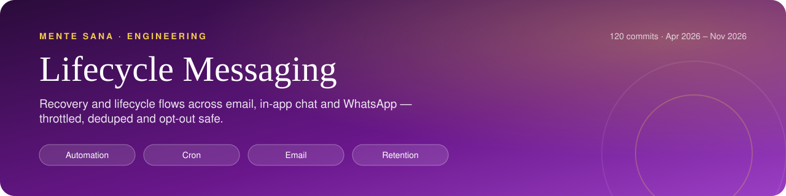

     

<h1 align="center">Lifecycle Messaging Engine: Mente Sana</h1>
<!-- /header -->

**The email, in-app and WhatsApp automation layer behind an online psychology clinic in Spain.** It covers transactional receipts, booking reminders, abandoned-checkout recovery, post-session upsells and bono renewals. Every flow runs on scheduled jobs, every send is logged, and a patient who has asked us to stop never hears from us again.

> Extracted from the private production monorepo of [Mente Sana Psicología](https://mentesanapsicologia.com) (8,000+ patients, 150+ licensed psychologists). The real git history is preserved: 121 commits, April–October 2026. Secrets and personal data are redacted.

---

## At a glance

<table>
  <tr>
    <td align="center" width="25%"><b>41 cron routes</b> Jobs</td>
    <td align="center" width="25%"><b>56 registry entries</b> Templates</td>
    <td align="center" width="25%"><b>Throttle, dedupe, opt-out, exclusions</b> Safeguards</td>
    <td align="center" width="25%"><b>Email · in-app chat · WhatsApp</b> Channels</td>
  </tr>
</table>

## The problem

Mente Sana sells a low-cost **diagnostic session (9,99 €)** as a way in, then **session bundles ("bonos")** with a psychologist. That makes the revenue path long and it leaks at every step:

- People reach the checkout and leave. Others leave an email in the test gate and never book.
- People book a session and then don't confirm or don't show up.
- Patients finish the diagnostic and don't buy a bono.
- Active patients run out of sessions, let the bono expire, or lose their psychologist when she leaves.

Each of these needs a different message at a different time on a different channel. In a mental-health product the message must **never** reach someone who asked for a refund, complained or said "stop writing to me". Doing this by hand did not scale, and a generic marketing tool can't see the clinical booking system (Amelia, on WordPress/MySQL) or the payment records.

## What I built

| Area | What it does |
|---|---|
| **Email template library** | 41 TypeScript template modules on one shared, inline-styled layout that works across email clients (`layout.ts`). Covered: payment receipts per product (diagnostic, speech therapy, nutrition), slot-taken fallback, test reminders, report delivery, review requests, app download/update, chat notifications, reactivation, offers and the post-session upsell store. |
| **Template registry + preview** | `registry.ts` lists **56 templates** (53 email and 3 WhatsApp) across 7 categories. Each one has a label, a trigger description and an `editable` level (code, timing or copy) and renders with sample data. It feeds an internal `/flujos` panel where the team browses, previews and edits copy and timings without a deploy. |
| **Provider wrapper** | `sendEmail()` wraps the Brevo transactional API. It supports a per-sender display name ("email from your psychologist"), reply-to, attachments by URL or base64, flow **tags** for metrics and an **idempotency key**: if Brevo reports `duplicate_parameter`, the send counts as a success, not an error. |
| **Recovery sequences** | One unified cron runs every 30 min and calls six runners: abandoned checkout, lead without purchase, post-session without purchase, post-session upsell, app download and app purchase. Each run sends **at most one step per recipient per sequence**, and one failing runner doesn't stop the others. |
| **Booking "confirm-your-session" cadence** | A cron runs every 5 min and steps through about 10 steps (email, WhatsApp and push placeholders) from T+2 min after booking to T−15 min before the slot. It **stops the moment the patient confirms**. If the patient has already logged into the app, only one soft reminder goes out. |
| **Post-diagnostic drip** | A daily sequence with six stacked checks so that nobody who already bought a bono receives it (details below). |
| **Situation-based outreach engine** | `app-outreach.ts` picks **one** message per patient per day from live booking and payment data. It shares its rules, logs and cooldowns with a WhatsApp version (see below). |
| **Fulfilment and ops crons** | Paid session summaries and attendance certificates, review requests, chat-reply email notifications (coalesced), scheduled one-off sends and campaigns from the panel, T−3/5 h "complete your test" reminders, and a weekly report for the lead psychologists. |

### The outreach engine in one paragraph

`decideRule(patient, now, config, channel)` is a **pure function with no I/O**. It takes a snapshot built from Amelia bonos, Stripe/DB payments, the outreach log and chat activity, and returns either a decision or a reason to skip. The rules are checked in priority order:

1. The psychologist has left → a check-in message
2. 2 sessions or fewer left → renewal
3. The bono expires within 14 days → offer to extend it
4. A patient for 2 months or more who hasn't had the 19,99 € extra session offered → one offer, sent once ever
5. The bono expired 60 days ago or less → renew
6. Paid the 9,99 € diagnostic 3–60 days ago and never bought therapy → a 6-step "remark" sequence, one step per Madrid calendar day. It stops if the patient replies or a team member writes.

The rules and windows sit in one `OUTREACH_CONFIG` object. Every skip carries a human-readable reason, which the panel shows to the team.

## Architecture

```mermaid
flowchart LR
  subgraph Triggers
    VC[Vercel Cron<br/>every 1 / 5 / 15 / 30 min,<br/>hourly, daily]
    WH[Stripe webhook /<br/>booking & chat events]
    PANEL[/flujos admin panel<br/>compose & schedule/]
  end

  subgraph Data["Source of truth"]
    AM[(Amelia MySQL<br/>bookings & bonos)]
    SB[(Supabase<br/>payments, leads, chat)]
  end

  subgraph Rules["Rules & safeguards"]
    RUN[Sequence runners<br/>1 step / recipient / run]
    DEC[decideRule&#40;&#41;<br/>pure, per channel]
    GATE{Opt-out lists · message patterns<br/>excluded patients · cooldown 3d<br/>rule repeat 14d · daily cap<br/>re-check before send}
  end

  subgraph Render
    REG[Template registry<br/>56 templates]
    LAY[Shared layout<br/>+ copy overrides]
  end

  subgraph Delivery
    BREVO[Brevo SMTP API<br/>tags + idempotency key]
    CHAT[In-app chat<br/>+ push + email]
    WA[WhatsApp scheduled<br/>templates queue]
  end

  LOGS[(Send logs<br/>sent_steps · *_log tables<br/>app_outreach_log · bulk_sends)]

  VC --> RUN & DEC
  WH --> RUN
  PANEL --> REG
  AM & SB --> RUN & DEC
  RUN & DEC --> GATE --> REG --> LAY
  LAY --> BREVO & CHAT & WA
  BREVO & CHAT & WA --> LOGS
  LOGS -. cadence & dedupe .-> GATE
```

The log is not just for auditing. Each sequence reads it back to work out the next step, the cooldown and whether something was already sent.

## Safeguards (what stops a message)

| Safeguard | Where |
|---|---|
| **Opt-out lists**: manual do-not-contact list (email or phone), marketing unsubscribes, post-diagnostic unsubscribes | `loadBaseSnapshots()` in `app-outreach.ts`; `post-diag-sequence` |
| **Intent detection in the patient's own messages**: refund, complaint, "not interested", "stop writing" (Spanish regex plus a SQL `ILIKE` mirror), checked in app chat and WhatsApp | `EXCLUSION_PATTERNS` / `EXCLUSION_ILIKE` |
| **WhatsApp "stop receiving" from Meta** → excluded | `applyWaSignals()` |
| **Central excluded-patients list**, applied to every new base of recipients | `dropExcludedPatients()` |
| **Internal and test addresses** filtered out | `esInterno()` |
| **Cooldown**: no automated message within 3 days of any template or human message, **across channels** | `decideRule()` |
| **Rule repeat**: the same rule isn't sent again within 14 days on the same channel; the 19,99 € offer is sent once ever | `decideRule()` |
| **Hand-off to humans**: if the patient has an unanswered chat message, the automation skips them | `waitingForAgent` |
| **Idempotency**: `sent_steps[]` per booking, `UNIQUE(customer_id, step)` logs, `UNIQUE(appointment_id)` for review requests, `test_reminder_sent_at`, Brevo idempotency keys | the individual crons + `send.ts` |
| **Race-condition re-check**: purchase status is queried again just before each send | `post-diag-sequence` |
| **Kill switches and caps**: outreach sends only when `APP_OUTREACH_AUTO=1` / `WA_OUTREACH_AUTO=1` and otherwise returns a dry-run plan; daily caps, with remark continuations given priority | `cron/app-outreach`, `cron/wa-outreach` |
| **Fail closed**: if the booking DB doesn't respond, the outreach run aborts with a 503 instead of guessing | `cron/app-outreach` |
| **Coalescing**: ten chat replies in a row produce one notification email at minute 15 | `schedule-app-chat-notification.ts` |
| **B2B / white-label sessions** excluded from review requests | `send-review-requests` |
| **Cron auth**: `Authorization: Bearer CRON_SECRET` on every job | all routes |

## Key decisions & trade-offs

- **One cron slot, many sequences.** Vercel limits the number of cron entries, so the recovery sequences run as runners inside one `recuperacion-emails` route. Each runner sits in its own `try/catch`, so one failure doesn't block the others. The thin per-sequence routes stay in place for manual testing.
- **Exit by query, not by state machine.** A lead leaves "lead without purchase" because once they book or pay, the query no longer returns them. That means no unsubscribe-on-purchase bookkeeping that can drift out of sync.
- **Pure decision function.** `decideRule()` takes plain snapshots, so it is deterministic and testable. The panel also uses it to show *why* each patient was or wasn't picked. The cost is a heavy loader (`loadBaseSnapshots`) that joins MySQL and Postgres in memory and pages around PostgREST's 1,000-row limit (`fetchAll`).
- **Timezone-correct daily jobs.** Vercel schedules in UTC and Spain switches between CET and CEST. The daily outreach crons are triggered at two UTC hours and only the call that lands at 9:00 `Europe/Madrid` runs. WhatsApp runs at 9:30, after the app run, so the cross-channel cooldown can see the app sends.
- **Dry-run by default.** New automation ships returning its plan (candidates, skips with reasons, missing templates). It sends only after someone sets an environment flag.
- **Copy outside the deploy cycle.** Templates are code, so they are type-safe and diffable. The registry also allows `timing` and `copy` overrides from the panel, so the marketing team can iterate without a release.
- **Best-effort notifications.** A chat-notification email can never block or roll back the actual chat reply.
- **Trade-off accepted:** templates are hand-written inline-HTML strings rather than MJML or React Email. That is fast to iterate and has no build step, but there is more repeated markup.

## Code tour

| Path | What to look at |
|---|---|
| `src/lib/app-outreach.ts` | `OUTREACH_CONFIG`, `decideRule()`, `EXCLUSION_PATTERNS`, `loadBaseSnapshots()`, `runOutreach()` (worker pool with concurrency 3, then batch log) |
| `src/lib/emails/send.ts` | Brevo wrapper: tags and idempotency |
| `src/lib/emails/layout.ts` | Shared responsive email shell |
| `src/lib/emails/registry.ts` | Catalog of 56 templates with triggers, channels and edit levels |
| `src/lib/emails/upsell-flows.ts` | 4 upsell flows (one per bono type) declared as data: `{ id, trigger, email }` with business rules in the header |
| `src/lib/emails/upsell-paid-sync.ts` | Reads Stripe to see who paid the extra session, adds it to their Amelia bono (idempotent) and notifies ops |
| `src/lib/emails/schedule-app-chat-notification.ts` | Coalesced notification queue |
| `src/app/api/cron/recuperacion-emails/` | Unified recovery cron (every 30 min) |
| `src/app/api/cron/bienvenida-ametralladora/` | Confirm-your-session cadence (every 5 min) |
| `src/app/api/cron/post-diag-sequence/` | Daily drip with six checks |
| `src/app/api/cron/app-outreach/`, `wa-outreach/` | Daily outreach runs gated to Madrid time |
| `src/app/api/cron/flujos-scheduled/` | Every minute: one-off sends and Brevo list campaigns scheduled from the panel |
| `src/app/api/cron/send-review-requests/`, `diagnostico-test-reminder/`, `justificantes-fulfill/`, `resumenes-fulfill/` | Transactional and fulfilment jobs |

The `cron/` folder has **41 routes** in total. Besides lifecycle messaging, the folder holds jobs from the same platform for ads sync and budget rules, WhatsApp number quality monitoring, conversation routing and scoring, embeddings for internal search, blog publishing and partner payouts. Only the messaging jobs are described here.

## Testing

- `src/lib/emails/send.test.ts` (Vitest) stubs `fetch` and checks that flow tags reach the Brevo payload while the recipient and untagged sends stay unchanged.
- `decideRule()` is pure and was unit-tested in the source monorepo (see the 17-Oct-2026 commits: rule engine, WhatsApp template rotation and channel tests). **Those test files are not part of this extract.**
- Operational checks built into the code: dry-run plans, preview endpoints for every template in the registry, and per-run JSON summaries (candidates, sent, failed, skipped and the reasons).

## Stack

TypeScript · Next.js 16 (App Router route handlers) · Vercel Cron · Supabase (Postgres) · Amelia booking plugin (MySQL) · Brevo (transactional and campaigns API) · Stripe · WhatsApp Cloud API (through an internal inbox service) · Vitest

## About this repo

- This is a **read-only showcase** extracted from a private production monorepo, with the real commit history (Apr–Oct 2026). Commit messages are in Spanish, like the original team's.
- It is **not runnable on its own.** It imports modules that aren't included: the sequence runners (`flujos-recuperacion-runners`, `flujos-upsell-runner`, `flujos-app-runner`), `wa-outreach.ts`, `excluded-patients.ts`, `support-start-chat.ts`, the Amelia DB client and part of the template set under `src/emails/`. There is also no `package.json`, schema or `vercel.json`.
- Secrets, keys and patient data have been removed or replaced with placeholders.
- Author: **Alejandro Álvarez**, CTO at Mente Sana. I designed and built this end to end: product rules with the business team, data model, crons, templates and the admin tooling.
